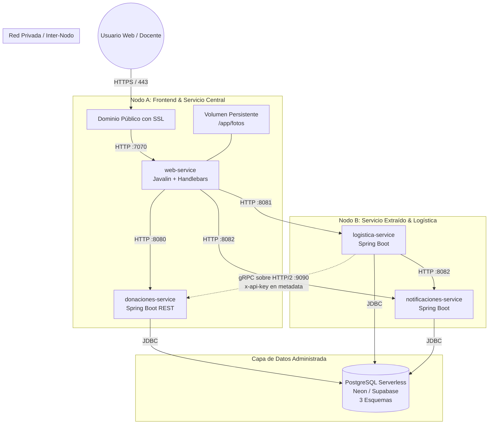

# Informe Comparativo de Opciones de Despliegue en la Nube

**Cátedra:** Diseño de Sistemas de Información (DSI / DDSI) — UTN FRBA  
**Proyecto:** DonaTrack — Plataforma de Gestión y Logística de Donaciones  
**Entrega:** TPA 4 — Requerimiento 4: Despliegue en la Nube y Topología de Red

---

## 1. Contexto y Requerimientos de la Aplicación

Para evaluar objetivamente las alternativas de infraestructura, debemos partir de las demandas técnicas concretas del ecosistema **DonaTrack**:

1. **4 Servicios Independientes:**
   * `web-service` (Frontend MVC con Javalin y Handlebars, accesible públicamente por HTTPS en el puerto `7070`).
   * `donaciones-service` (Servicio Central: REST en `:8080` + **Servidor gRPC en `:9090` con HTTP/2**).
   * `logistica-service` (Servicio Extraído: REST en `:8081` + **Cliente gRPC hacia `:9090`**).
   * `notificaciones-service` (Servicio de Soporte: REST en `:8082`).
2. **Recomendación de Nodos Separados (Consigna TPA 4, Nota al pie [^2]):**
   > *"Idealmente tanto el servidor principal (`donaciones-service`) como el servicio extraído en la entrega 2 (`logistica-service`) deberían ser desplegados en nodos diferentes. Si esto no fuera posible, se aceptará desplegar ambos en el mismo nodo."*
   El despliegue en nodos separados valida la resiliencia, el aislamiento de fallas y la verdadera comunicación de red inter-nodo (evitando la ilusión de `localhost`).
3. **Canal gRPC Interno (HTTP/2 Puro):**
   La comunicación entre `logistica-service` y `donaciones-service` se realiza mediante gRPC. El proveedor de nube debe soportar **red privada interna (Private Networking / VPC)** o permitir transporte de tráfico HTTP/2 sin degradarlo a HTTP/1.1 ni bloquear puertos secundarios.
4. **Base de Datos Relacional:**
   PostgreSQL con 3 bases independientes (`donaciones`, `logistica`, `notificaciones`).
5. **Persistencia de Fotos (Req. 12):**
   Las fotos de confirmación de entrega cargadas por las entidades se almacenan en disco (`FOTOS_DIR`). La plataforma requiere un **volumen persistente** para evitar que los archivos se borren ante reinicios o nuevos despliegues.
6. **Consumo de Memoria:**
   4 aplicaciones Spring Boot en Java 21 consumen en conjunto entre 1.5 GB y 2 GB de memoria RAM.

---

## 2. Análisis Detallado de las 5 Opciones

---

### Opción 1: PaaS Híbrido — Railway + Neon
*Plataforma como Servicio (PaaS) moderna combinada con Base de Datos Serverless.*

* **Arquitectura de Nodos:** Cada microservicio se despliega como un *Service Container* independiente en Railway, ejecutándose en **nodos de cómputo aislados**. Cumple de forma nativa la recomendación de nodos separados para Donaciones y Logística.
* **Soporte gRPC y Red:** Railway provee **Private Networking** automática basada en IPv6/DNS interno (`.railway.internal`). `logistica-service` se conecta a `donaciones-service.railway.internal:9090` directamente por HTTP/2, sin exponer el puerto gRPC al Internet público y con latencia de red interna sub-milisegundo.
* **Base de Datos (Neon):** Neon ofrece PostgreSQL serverless gratuito que no se vence, con soporte para las 3 bases de datos y escalabilidad automática a cero cuando no se usa.
* **Persistencia de Fotos:** Railway permite asociar un **Persistent Volume** al `web-service` montado en `/app/fotos` en un par de clics.
* **Ventajas:**
  * Despliegue automático conectado al repositorio GitHub en cada push a `entrega-4`.
  * Sin tiempos de "apagado por inactividad" (*no cold-starts*): la demo responde inmediatamente en la presentación.
  * Solo se expone públicamente el `web-service` con certificado SSL/HTTPS automático provisto por Railway.
* **Desventajas:**
  * Railway ofrece un crédito de prueba inicial ($5 USD); luego requiere plan Hobby si se supera el consumo mensual.

---

### Opción 2: IaaS Cloud — Oracle Cloud Infrastructure (OCI) Always Free
*Infraestructura como Servicio (IaaS) con máquinas virtuales dedicadas sin costo.*

* **Arquitectura de Nodos:** El nivel gratuito de OCI (*Always Free*) otorga hasta 4 núcleos de CPU Ampere (ARM64) y **24 GB de memoria RAM**, que pueden dividirse en **hasta 2 o 4 Máquinas Virtuales (VMs) separadas**:
  * **VM 1 (Nodo Principal):** Aloja `web-service` y `donaciones-service`.
  * **VM 2 (Nodo Secundario):** Aloja `logistica-service`, `notificaciones-service` y PostgreSQL.
  Esto cumple **con creces la separación física de nodos** en diferentes instancias virtuales dentro de una misma Virtual Cloud Network (VCN).
* **Soporte gRPC y Red:** Al ser máquinas virtuales Linux completas (Ubuntu), gRPC corre sobre TCP nativo sin ninguna intermediación de proxies de terceros. Se configura una regla de firewall en la subred interna para permitir el tráfico en el puerto `9090`.
* **Persistencia:** Almacenamiento en disco de bloque (Block Volume) estándar de Linux (50 GB a 200 GB gratuitos), garantizando que las fotos nunca se pierdan.
* **Ventajas:**
  * **100% Gratuito de por vida:** No vence al mes ni depende de créditos temporales.
  * Permite ejecutar directamente el `docker-compose.yml` del proyecto.
  * Gran capacidad de cómputo (24 GB de RAM disponibles frente a los 512 MB de la mayoría de PaaS gratuitos).
* **Desventajas:**
  * Mayor complejidad operativa: requiere configurar llaves SSH, firewall de Linux (`iptables` / Security Lists de OCI) y Docker en el servidor.
  * El proceso de registro en Oracle Cloud exige tarjeta de crédito para validar identidad (aunque no cobra).

---

### Opción 3: PaaS Tradicional — Render + Supabase
*Plataforma como Servicio con capa gratuita popular pero con limitaciones operativas.*

* **Arquitectura de Nodos:** Permite configurar servicios web independientes en contenedores separados (multi-nodo).
* **Soporte gRPC y Red:** 
  * Render en su capa gratuita enruta el tráfico público a través de un proxy HTTP/1.1 que dificulta o degrada el tráfico gRPC.
  * Aunque cuenta con red privada interna, el plan gratuito impone limitaciones en el mapeo de múltiples puertos para un mismo servicio (donaciones requiere `:8080` para REST del front y `:9090` para gRPC de logística).
* **Base de Datos (Supabase):** PostgreSQL administrado gratuito, altamente confiable.
* **Persistencia de Fotos:** **Punto crítico:** Render Free **no admite discos persistentes**. En cada reinicio o suspensión del contenedor, las fotos cargadas se pierden irremediablemente.
* **Problema de "Cold Start":** Los servicios en Render Free se suspenden tras 15 minutos de inactividad. Al recibir una petición, tardan entre **50 y 90 segundos en arrancar**. En una arquitectura de 4 servicios Java donde uno llama al otro en cascada, la primera petición puede superar los timeouts de la interfaz web, arruinando la fluidez de la presentación.
* **Veredicto:** No recomendable para la arquitectura actual de DonaTrack debido a los cold-starts y la falta de almacenamiento persistente.

---

### Opción 4: Despliegue Híbrido Local + Cloudflare Tunnels (Edge Computing)
*Ejecución local en hardware propio con túnel seguro de exposición pública.*

* **Arquitectura de Nodos:** Se ejecutan los servicios en una o dos computadoras del equipo (ej. donaciones en una PC y logística en otra mediante red local o Docker Compose en red puente).
* **Exposición Pública:** Se utiliza `cloudflared` (Cloudflare Tunnel) para conectar el puerto local `7070` con un subdominio público HTTPS con CDN y protección DDoS gratuita, sin necesidad de abrir puertos en el router hogareño ni lidiar con IP dinámica.
* **Soberanía Digital y Privacidad:**
  * La consigna de la cátedra menciona explícitamente esta alternativa: los datos de donantes y entidades residen exclusivamente en hardware bajo control del equipo, sin transferirse a servidores de multinacionales extranjeras (AWS, Microsoft, Google).
* **Ventajas:**
  * Cero costo. Cero problemas de memoria RAM o límites de disco.
  * Control absoluto de los logs y debugging en tiempo real.
* **Desventajas:**
  * Requiere que la computadora esté encendida y conectada a internet durante el momento de la evaluación.
  * La consigna exige acordarlo previamente con el ayudante del grupo.

---

### Opción 5: Infraestructura Universitaria — DISILAB (UTN FRBA)
*La nube académica del Departamento de Ingeniería en Sistemas de Información.*

#### 5.1 ¿Qué es el DISILAB y cuál es su rol?
El **DISILAB** es el Laboratorio de Sistemas de la UTN Facultad Regional Buenos Aires (con presencia física en Campus Medrano y Campus Lugano). Proporciona a los estudiantes y docentes de la carrera una plataforma de infraestructura virtualizada local para proyectos académicos, trabajos prácticos y proyectos finales de grado.

#### 5.2 Arquitectura y Capacidades Técnicas
* **Plataforma de Cómputo:** El DISILAB cuenta con un cluster de servidores físicos propios gestionados mediante tecnologías de virtualización de código abierto (habitualmente **Proxmox VE / KVM** y plataformas de orquestación de contenedores tipo **Kubernetes / OpenShift** o Docker Swarm académico).
* **Separación de Nodos:** A través del DISILAB es posible solicitar:
  * O bien dos **Máquinas Virtuales Linux (VMs)** independientes conectadas en una red interna virtual (VLAN / bridge), asignando una VM para el servicio central y otra para el servicio extraído.
  * O bien un espacio de nombres (*namespace*) dentro del cluster de Kubernetes de la facultad, donde cada microservicio corre en un `Pod` que el *scheduler* distribuye en distintos nodos físicos del cluster.
* **Canal gRPC y Red:** Al operar dentro de la red del laboratorio:
  * La resolución de nombres interna (DNS) permite conectar `logistica-service` con `donaciones-service:9090` con tráfico HTTP/2 nativo a velocidad de datacenter local (gigabit ethernet).
  * No hay bloqueos de puertos inter-servicios.
* **Persistencia:** Soporte de volúmenes locales en el almacenamiento del datacenter (*Persistent Volume Claims* o discos virtuales qcow2), garantizando la persistencia de la base de datos y de las fotos de donaciones (`/app/fotos`).
* **Acceso Público:** El DISILAB asigna una IP pública o un subdominio institucional (por ejemplo `donatrack-g8.disilab.frba.utn.edu.ar`) con certificado SSL, o un túnel inverso/proxy inverso Nginx administrado por el lab.

#### 5.3 Ventajas Estratégicas para el TPA
1. **Soberanía y Entorno Institucional:** Todo el ciclo de vida del software corre en la propia universidad, alineándose con las políticas de soberanía tecnológica promovidas por el departamento.
2. **Sin Barreras Económicas ni Tarjetas:** No requiere tarjetas de crédito internacionales, no depende de períodos de prueba de 30 días que expiran antes del coloquio, ni corre riesgo de facturación sorpresa.
3. **Recursos Adecuados para Java:** La facultad asigna cuotas de memoria suficientes (típicamente 2 a 4 GB por grupo), lo que permite que los 4 servicios Spring Boot inicien sin problemas de Out-Of-Memory (OOM).

#### 5.4 Consideraciones y Desafíos Operativos
* **Gestión de Accesos y Burocracia:** El alta de cuentas y asignación de recursos depende de los administradores del laboratorio y del aval de la cátedra; no es auto-servicio instantáneo como crear una cuenta en Railway.
* **Ventanas de Mantenimiento:** La infraestructura puede estar sujeta a cortes de energía programados en las sedes de la facultad o tareas de mantenimiento durante fines de semana.

---

## 3. Matriz Comparativa Integral

| Criterio | 1. Railway + Neon | 2. Oracle Cloud (IaaS) | 3. Render + Supabase | 4. Cloudflare + Local | 5. DISILAB (UTN) |
|---|:---:|:---:|:---:|:---:|:---:|
| **Despliegue en Nodos Separados** | **Sí** (Contenedores en pods independientes) | **Sí** (2 VMs en la misma VCN) | **Sí** (Servicios separados) | **Parcial** (Misma máquina o red local) | **Sí** (VMs o Pods en cluster) |
| **Soporte gRPC (HTTP/2 :9090)** | **Excelente** (Red privada nativa) | **Excelente** (TCP nativo en Linux) | **Deficiente** (Proxy HTTP/1.1 en free tier) | **Excelente** (Local / Docker network) | **Excelente** (Red interna LAN/K8s) |
| **Persistencia de Fotos (Disco)** | **Sí** (Persistent Volume) | **Sí** (Disco de bloque VM) | **No** (Disco efímero en free tier) | **Sí** (Disco rígido local) | **Sí** (Volumen virtualizado) |
| **Riesgo de "Cold Start"** | **Nulo** (Siempre activo) | **Nulo** (Servidor dedicado) | **Alto** (50-90s tras inactividad) | **Nulo** (Siempre activo) | **Nulo** (Siempre activo) |
| **Costo y Requisitos** | Crédito inicial / Económico | **Gratis** (Requiere tarjeta para alta) | Gratis con limitaciones | **Gratis** (Requiere PC encendida) | **Gratis** (Gestión con la facultad) |
| **Tiempo de Puesta en Marcha** | **~30 minutos** | ~2 a 3 horas | ~1 hora | ~1 hora | Depende de asignación de cuenta |

---

## 4. Topología Recomendada para la Entrega

Para maximizar la nota y garantizar una demostración fluida y profesional en el coloquio, la estrategia óptima recomendada es:

### Justificación de esta Topología:
1. **Cumplimiento estricto de la consigna:** Donaciones (servicio principal) y Logística (servicio extraído) se ejecutan en **nodos virtuales distintos**.
2. **Seguridad y Aislamiento:** El puerto gRPC `:9090` no está expuesto a Internet; solo es visible por Logística a través del canal privado seguro con autenticación `x-api-key`.
3. **Resiliencia de Datos:** La base de datos es independiente de los ciclos de vida de los contenedores de aplicación, y las fotos subidas residen en un volumen persistente.
4. **Presentación sin sobresaltos:** Al no tener suspensiones por inactividad, los docentes podrán navegar el sitio, registrarse, planificar rutas y verificar el mapa sin experimentar demoras de arranque.
