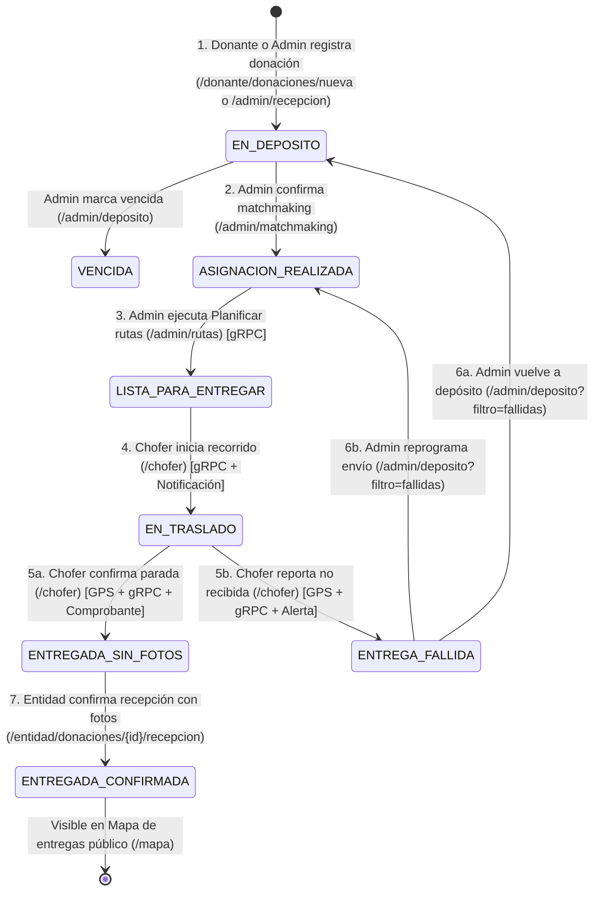
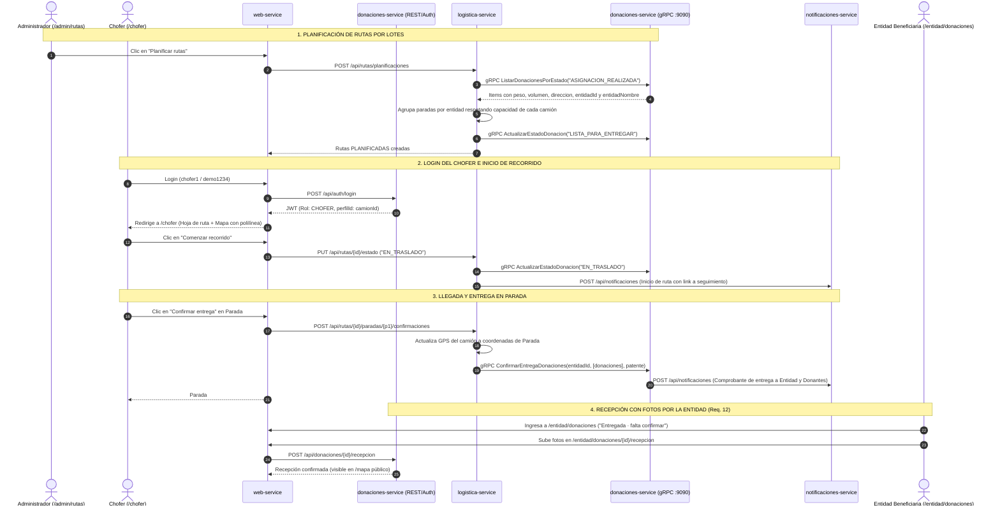

# Plan Unificado: Rol Chofer, Hoja de Ruta y Ciclo de Vida Completo de una Donación

Documento técnico que integra el diagnóstico del ciclo de vida ([TPA1](ConsignaTPA1.md), [TPA2](ConsignaTPA2.md) y [TPA4](ConsignaTPA4.md)) con el diseño del **Rol Chofer (`/chofer`)**, la **Planificación de Rutas (`/admin/rutas`)** y la **Gestión de Entregas Fallidas (`/admin/deposito`)** para completar todo el circuito de punta a punta desde la interfaz web.

---

## 1. Diagnóstico y Decisiones de Diseño

### 1.1 Qué faltaba para cerrar el ciclo de vida en la web
En [ConsignaTPA4.md](ConsignaTPA4.md) se solicita interfaz gráfica para todas las funcionalidades de entregas previas, pero el listado numerado de pantallas (1 al 19) omitió la operatoria intermedia de `logistica-service` (planificación de rutas por lotes, salida del camión, telemetría en mapa y confirmación o rechazo en cada parada). Por eso en [FlujosDePrueba.md](FlujosDePrueba.md) era necesario ejecutar comandos manuales contra `localhost:8081`.

Además existían **3 desconexiones técnicas en el backend**:
1. **El planificador perdía el `entidadId` y la dirección real:** `DonacionItem` en `donaciones.proto` y `DonacionAsignadaResponse` no incluían `entidadId` ni `entidadNombre`, y `GestorPlanificacionRutas` armaba una única parada ficticia en `"Medrano 951, CABA"` con `entidadId = null`, impidiendo el seguimiento por entidad y fallando al confirmar la parada vía gRPC.
2. **El fallo en parada no notificaba a `donaciones-service` ni cerraba la ruta:** `RutaServiceImpl.registrarEntregaNoRecibida` solo marcaba la parada como `NO_RECIBIDA` localmente sin invocar `donacionesGrpcClient.actualizarEstado(..., "ENTREGA_FALLIDA", motivo)` ni finalizar automáticamente la ruta al resolver todas sus paradas.
3. **Las donaciones en `ENTREGA_FALLIDA` quedaban sin gestión en Depósito:** `Donacion` no permitía reprogramar una entrega fallida a `ASIGNACION_REALIZADA`, y `/admin/deposito` solo listaba `EN_DEPOSITO` y `VENCIDA`.

### 1.2 Decisiones de Arquitectura y UX Acordadas (Rol Chofer + Administración)
- **Rol `CHOFER` vinculado al camión (`perfilId = camionId`):**
  - Cada cuenta con rol `CHOFER` tiene como `perfilId` el ID del camión que conduce.
  - Desde **Camiones** (`/admin/camiones`), el Administrador puede crear o actualizar opcionalmente el usuario y contraseña del chofer al dar de alta o editar un camión.
  - En el seed de demostración quedan precargados:
    - `chofer1` / `demo1234` → Camión `AF456DE` (con la Ruta activa del día `EN_TRASLADO` hacia *Comedor Los Pibes* y *Merendero Rayito de Sol*).
    - `chofer2` / `demo1234` → Camión `AE123BC`.
    - `chofer3` / `demo1234` → Camión `AD789FG` (con la Ruta `PLANIFICADA` hacia *Escuela Comunitaria N 12*).
- **Portal del Chofer (`/chofer` — "Hoja de ruta"):**
  - Navegación enfocada exclusivamente en su **ruta activa del día** (`EN_TRASLADO` o próxima `PLANIFICADA`), más el acceso público al *Mapa de entregas* y cierre de sesión en la barra superior.
  - **Mapa interactivo Leaflet con trazado del recorrido:** muestra el Depósito central (inicio), los marcadores numerados de cada parada (`1`, `2`, ...), la polilínea (`L.polyline`) conectando los puntos en orden óptimo y el marcador del camión `🚚` en su posición actual.
  - **Inicio de viaje:** cuando la ruta está `PLANIFICADA`, el chofer toca **"Comenzar recorrido"**, pasando la ruta y sus donaciones a `EN_TRASLADO` vía gRPC, ubicando el camión en el depósito y notificando a donantes y entidades.
  - **Confirmación o fallo por parada completa con salto automático en el mapa y modal al finalizar:** al llegar a una parada, el chofer confirma la entrega (o reporta que no pudo ser recibida con motivo). `logistica-service` actualiza automáticamente la ubicación GPS del camión a las coordenadas de esa parada, propaga `ENTREGADA` o `ENTREGA_FALLIDA` vía gRPC y, si era la última parada pendiente, pasa la ruta a `FINALIZADA` y muestra un modal de ruta completada (`/chofer?completada={id}`).
- **Panel Administrativo de Rutas (`/admin/rutas`) y Entregas Fallidas (`/admin/deposito`):**
  - El Administrador dispone de **`/admin/rutas`** para disparar **"Planificar rutas"** con un clic (procesando las donaciones en `ASIGNACION_REALIZADA` según peso y volumen de los camiones disponibles) y consultar la hoja de ruta de toda la flota.
  - En **`/admin/deposito?filtro=fallidas`**, una tercera pestaña **"Entregas fallidas"** permite **Reprogramar el envío** (`ASIGNACION_REALIZADA` para la misma entidad) o **Volver a depósito** (`EN_DEPOSITO` para reingresar al stock y matchmaking).

---

## 2. Diagramas del Ciclo Completo

### 2.1 Máquina de Estados de la Donación (100% Web)

### 2.2 Secuencia E2E del Circuito Logístico y Rol Chofer

---

## 3. Bocetos de Interfaz (`documents/bocetos/`)

Siguiendo el flujo obligatorio de [`AGENTS.md`](../AGENTS.md) (*primero el boceto PNG de 1280 px con `styles.css` real, después el código*):

1. **`16-deposito.png` y `16c-deposito-fallidas.png`** (`/admin/deposito`): Depósito actualizado con la 3.ª pestaña **"Entregas fallidas"**, motivo reportado y botones *Reprogramar envío* / *Volver a depósito*.
2. **`18b-camiones-alta.png`** (`/admin/camiones`): Modal de alta/edición de camión actualizado con la sección opcional de credenciales de acceso para el Chofer (`usuario` y `contraseña`).
3. **`18d-chofer-hoja-de-ruta.png`** (`/chofer`): Vista principal del Chofer con datos de su camión, mapa Leaflet (depósito, paradas numeradas, polilínea de ruta y camión `🚚`) y listado secuencial de paradas.
4. **`18e-chofer-confirmar-entrega.png`** (`/chofer?confirmarParada={id}`): Modal de confirmación de entrega en parada detallando la entidad destinataria y las donaciones a descargar.
5. **`18f-chofer-ruta-completada.png`** (`/chofer?completada={id}`): Modal de ruta completada al resolver todas las paradas del recorrido.
6. **`20a-rutas-listado.png`** (`/admin/rutas`): Pantalla administrativa de **Rutas y entregas** con métricas, botón **Planificar rutas** y pestañas por estado.
7. **`20b-rutas-hoja-de-ruta.png`** (`/admin/rutas?ver={id}`): Modal administrativo de **Hoja de ruta** con detalle de camión, chofer y estado de cada parada.

---

## 4. Cambios Técnicos por Módulo

### 4.1 `common-lib` y `grpc-contracts`
- **`common-lib/.../security/Rol.java`**: Agregar el valor `CHOFER`.
- **`grpc-contracts/src/main/proto/donaciones.proto`**: Agregar `int64 entidad_id = 5;` y `string entidad_nombre = 6;` en `DonacionItem`.

### 4.2 `donaciones-service`
- **Usuarios y Auth para Chofer:**
  - `Usuario.java`: Soportar `Rol.CHOFER` con `perfilId = camionId` obligatorio.
  - `UsuarioRepository.java` y `JpaUsuario.java`: Agregar `buscarPorRolYPerfilId(Rol rol, Long perfilId)` y `listarPorRol(Rol rol)`.
  - `CuentaChoferRequest.java`: DTO `(Long camionId, String username, String password)`.
  - `AuthService.java` / `AuthServiceImpl.java`: Métodos `configurarUsuarioChofer(CuentaChoferRequest)` (crea o actualiza usuario/contraseña del chofer asociado a `camionId`) y `listarUsuariosChofer()`.
  - `AuthController.java`: Exponer `POST /api/auth/chofer` y `GET /api/auth/choferes` (`ADMINISTRADOR, SISTEMA`), y habilitar `CHOFER` en `GET /api/auth/me`.
- **Donaciones y gRPC:**
  - `Donacion.java`: Método `reprogramarEntrega(String justificacion)` para pasar de `ENTREGA_FALLIDA` a `ASIGNACION_REALIZADA` manteniendo su entidad asignada.
  - `DonacionAsignadaResponse.java`, `DonacionServiceImpl.java` y `DonacionesGrpcServiceImpl.java`: Incluir `entidadId` y `entidadNombre` en las donaciones consultadas por estado y habilitar `ASIGNACION_REALIZADA` desde `ENTREGA_FALLIDA` en `cambiarEstado`.
  - `DonacionController.java` y `EntidadBeneficiariaController.java`: Permitir lectura a `CHOFER` en `GET /api/entidad-beneficiaria` y `GET /api/donaciones/{id}` para enriquecer la hoja de ruta con nombres de entidades y detalle de bultos.

### 4.3 `logistica-service`
- **Coordenadas determinísticas en CABA (`GeocodificadorCaba.java`):**
  - Define la ubicación del Depósito central (`Av. Medrano 951, CABA`: `-34.5986, -58.4202`) y resuelve coordenadas reales dentro de CABA para cada dirección/barrio de parada (Flores, Parque Avellaneda, San Cristóbal, Villa Crespo, Belgrano, Almagro y fallback determinístico en tierra firme).
- **Respuestas enriquecidas (`ParadaResponse` y `RutaResponse`):**
  - `ParadaResponse`: agrega `latitud` y `longitud` de la parada.
  - `RutaResponse`: agrega `camionId`, `camionLatitud` y `camionLongitud` (manteniendo constructores previos por compatibilidad con tests).
- **Planificador real por camión y entidad (`PlanificadorDeRutas` y `GestorPlanificacionRutas`):**
  - Excluye donaciones que ya estén en rutas `PLANIFICADA` o `EN_TRASLADO`.
  - Distribuye las donaciones en `ASIGNACION_REALIZADA` respetando `capacidadCarga` y `capacidadVolumen` de cada camión disponible y agrupando en una misma `Parada` las donaciones dirigidas a la misma `entidadId`.
- **Operación del Chofer, telemetría automática y gRPC (`Ruta`, `GestorDeRutas`, `RutaServiceImpl`, `RutaController`, `CamionController`):**
  - Al iniciar ruta (`EN_TRASLADO`): posiciona el camión en el Depósito si aún no tenía coordenadas de salida, actualiza las donaciones por gRPC y emite notificaciones de inicio.
  - Al confirmar parada (`confirmarEntregaExitosa`): verifica `EN_TRASLADO`, marca la parada `ENTREGADA`, mueve el GPS del camión a las coordenadas de la parada, cierra la ruta (`FINALIZADA`) si no quedan paradas `PENDIENTE` y confirma por gRPC.
  - Al reportar fallo (`registrarEntregaNoRecibida` con `motivo`): verifica `EN_TRASLADO`, marca `NO_RECIBIDA`, mueve el GPS del camión a la parada, cierra la ruta si corresponde e invoca `donacionesGrpcClient.actualizarEstado(donacionId, "ENTREGA_FALLIDA", motivo)`.
  - `CamionController`: habilita `CHOFER` (propietario de su `camionId`) en `GET /api/camiones/{id}`.
  - `RutaController`: agrega `GET /api/rutas/camion/{camionId}/activa` y `GET /api/rutas/camion/{camionId}`, y habilita `CHOFER` (validando que la ruta pertenezca a su `camionId`), `ADMINISTRADOR` y `SISTEMA` en el inicio de ruta y resolución de paradas.

### 4.4 `web-service`
- **Sesión y Roles:**
  - `RolUsuario.java`: agregar `CHOFER("/chofer", "Chofer")` (el login en `PanelController` redirige automáticamente a `rol.inicio()`, es decir `/chofer`).
  - `UsuarioVista.java`: agregar `boolean esChofer` para Handlebars (`{{#if usuario.esChofer}}`).
  - `EstadoHelper.java`: etiquetas amigables para estados de ruta y parada (`PLANIFICADA`, `FINALIZADA`, `PENDIENTE`, `NO_RECIBIDA`).
- **Clientes HTTP:**
  - `AuthApiClient`: `configurarUsuarioChofer` y `listarUsuariosChofer`.
  - `LogisticaApiClient`: `listarRutas`, `obtenerRuta`, `obtenerRutaActivaCamion`, `planificarRutas`, `cambiarEstadoRuta`, `confirmarParada` y `reportarFalloParada`.
- **Controladores y Vistas:**
  - `ChoferWebController` + `templates/chofer/hoja-de-ruta.html.hbs`: portal `/chofer` con mapa Leaflet + polilínea, inicio de viaje y modales de confirmar entrega y reportar entrega no recibida.
  - `RutasAdminController` + `templates/admin/rutas.html.hbs`: listado `/admin/rutas`, ejecución de `Planificar rutas` y modal de hoja de ruta.
  - `CamionesAdminController` + `templates/admin/camiones.html.hbs`: columna de usuario chofer y campos opcionales `choferUsername` / `choferPassword` en el modal de camión.
  - `DepositoAdminController` + `templates/admin/deposito.html.hbs`: pestaña `Entregas fallidas` con acciones `Reprogramar envío` y `Volver a depósito`.
  - `menu-lateral.html.hbs`, `admin/panel.html.hbs` y `Router.java`: enlaces de navegación y registro de rutas por rol.

### 4.5 Datos Demo y Pruebas
- **`docker/datos-demo/cargar-datos-demo.py` y `cargar-datos-demo.ps1`**: creación de `chofer1`, `chofer2` y `chofer3` (`demo1234`) asociados a los 3 camiones del seed y actualización de [`documents/FlujosDePrueba.md`](FlujosDePrueba.md).
- **Tests automatizados (`mvn test`)**: pruebas unitarias y de integración en `AuthServiceTest`, `DonacionServiceTest`, `DonacionesGrpcIntegrationTest`, `PlanificadorDeRutasTest`, `GestorDeRutasTest`, `RutaServiceTest`, `LogisticaAuthTest` y `WebFlujoTest`.

---

## 5. Checklist de Bocetos y Pantallas Implementadas

- [x] Bocetos PNG exportados en [`documents/bocetos/`](bocetos/) y registrados en [`documents/bocetos/README.md`](bocetos/README.md):
  - [x] `16-deposito.png` y `16c-deposito-fallidas.png` (`/admin/deposito`, `/admin/deposito?filtro=fallidas`)
  - [x] `18b-camiones-alta.png` (`/admin/camiones` con usuario chofer)
  - [x] `18d-chofer-hoja-de-ruta.png`, `18e-chofer-confirmar-entrega.png` y `18f-chofer-ruta-completada.png` (`/chofer`)
  - [x] `20a-rutas-listado.png` y `20b-rutas-hoja-de-ruta.png` (`/admin/rutas`)
- [x] Backend completo (`common-lib`, `grpc-contracts`, `donaciones-service` y `logistica-service`) con rol `CHOFER`, planificación por capacidad/entidad, GPS automático y propagación gRPC de `ENTREGA_FALLIDA`.
- [x] Pantallas implementadas en `web-service` (`/chofer`, `/admin/rutas`, `/admin/camiones`, `/admin/deposito?filtro=fallidas`).
- [x] Scripts de datos demo (`cargar-datos-demo.py` / `.ps1`), guía [`FlujosDePrueba.md`](FlujosDePrueba.md) y suite `mvn test` en verde en los 7 módulos.
