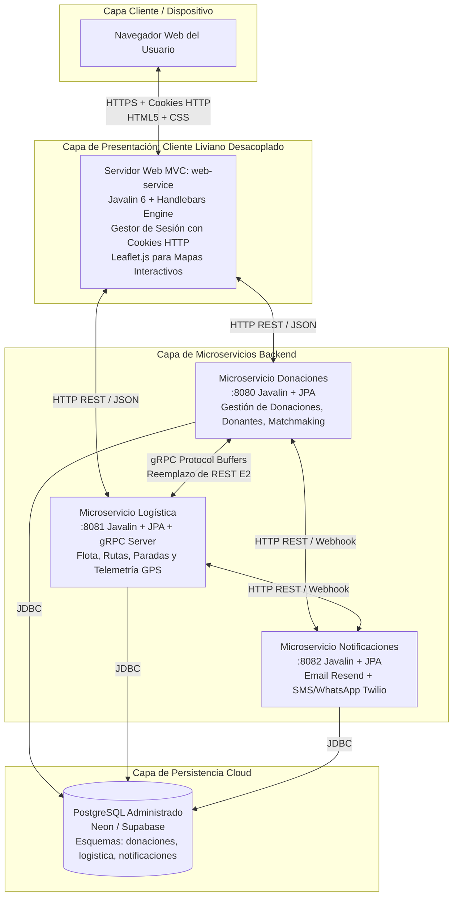

# Plan Integral de Acción — Entrega 4: Presentación y Despliegue
**DonaTrack — Diseño de Sistemas de Información (UTN FRBA)**

---

## 1. Resumen Ejecutivo y Objetivos

El presente documento establece el plan de trabajo detallado para completar la **Entrega 4: Presentación y Despliegue** del proyecto **DonaTrack**, conforme a las directivas estipuladas en [ConsignaTPA4.md](file:///Users/francoball/Estudio/UTN/3año/DSI/dsi-tpa-2026-DonaTrack-g8/ConsignaTPA4.md).

### Objetivos Principales:
* **Diseño UI/UX y Maquetado Web**: Diseñar e implementar interfaces modernas, responsivas y accesibles utilizando HTML5 y CSS Vanilla.
* **Cliente Liviano Desacoplado**: Implementar el patrón arquitectural MVC del lado del servidor utilizando **Javalin 6** y el motor de plantillas **Handlebars**, desacoplado de la lógica de dominio de los microservicios.
* **Autenticación y Sesiones con Cookies HTTP**: Gestionar la identidad y los permisos de acceso de usuarios (Donantes, Entidades y Administradores) mediante Cookies HTTP.
* **Integración de Servicios con Nuevo Protocolo**: Reemplazar la comunicación HTTP REST entre el servicio principal y el servicio extraído en la Entrega 2 ([logistica-service](file:///Users/francoball/Estudio/UTN/3año/DSI/dsi-tpa-2026-DonaTrack-g8/logistica-service)) por el protocolo de alto rendimiento **gRPC** con Protocol Buffers.
* **Despliegue en la Nube**: Desplegar el sistema completo en una infraestructura PaaS/IaaS pública (Render / Railway + base de datos administrada en Neon / Supabase), ejecutando el cliente web y los servicios en nodos independientes.

---

## 2. Arquitectura Objetivo de la Solución



---

## 3. Decisiones Clave de Diseño y Justificaciones

| Decisión | Opción Elegida | Justificación Técnica |
|---|---|---|
| **Motor de Plantillas** | **Handlebars (`com.github.jknack:handlebars`)** | Es el motor recomendado por la cátedra para Javalin en la guía de Bulgarelli. Proporciona separación estricta entre vista y lógica (*logic-less*), sintaxis limpia, soporte de layouts base y parciales reutilizables. |
| **Arquitectura Frontend** | **Cliente Liviano Desacoplado (`web-service`)** | Módulo Maven independiente que consume las APIs de los servicios backend y renderiza HTML en el servidor. Evita acoplar la capa web al dominio y permite escalar o desplegar el frontend de forma independiente. |
| **Manejo de Sesión** | **Cookies HTTP (`donatrack_session`)** | Requisito explícito de la consigna. Se utiliza una cookie HTTP `HttpOnly` y `SameSite` que almacena un identificador de sesión seguro, validado mediante middleware en cada petición. |
| **Protocolo Inter-servicios** | **Opción 1: gRPC** (sobre GraphQL) | La comunicación entre `donaciones-service` y `logistica-service` es inter-servicios (RPC interno de máquina a máquina). gRPC sobre HTTP/2 ofrece contratos estrictos (`.proto`), serialización binaria ultrarrápida, bajo consumo de ancho de banda y generación automática de stubs tipados en Java. |
| **Librería de Mapas** | **Leaflet.js + OpenStreetMap** | Solución abierta, liviana y sin necesidad de claves de API pagas. Permite renderizar tanto el mapa interactivo público como el seguimiento de camiones en tiempo real. |
| **Infraestructura Cloud** | **Render / Railway + Neon / Supabase** | Plataformas PaaS que admiten contenedores Docker multi-servicio, gestión de variables de entorno y PostgreSQL 16 administrado con SSL nativo. |

---

## 4. Desglose Fase por Fase

### Fase 0: Requisitos Previos y Habilitación de Backend
Antes de construir la interfaz gráfica, se deben garantizar los endpoints de soporte en los microservicios existentes:

1. **Módulo de Usuarios y Autenticación**:
   - Crear entidad `Usuario` con campos `id`, `username`, `passwordHash` (BCrypt), `rol` (`DONANTE`, `ENTIDAD_BENEFICIARIA`, `ADMINISTRADOR`) y referencia al id del perfil asociado.
   - Exponer endpoints en [donaciones-service](file:///Users/francoball/Estudio/UTN/3año/DSI/dsi-tpa-2026-DonaTrack-g8/donaciones-service):
     - `POST /api/auth/login`: valida credenciales y retorna los datos del usuario y su rol.
     - `POST /api/auth/registro`: registra el usuario asociado a un donante o entidad.
2. **Endpoint de Importación Masiva CSV (>10.000 filas)**:
   - Exponer en [DonanteController.java](file:///Users/francoball/Estudio/UTN/3año/DSI/dsi-tpa-2026-DonaTrack-g8/donaciones-service/src/main/java/ar/edu/utn/frba/ddsi/donaciones/controllers/DonanteController.java) el endpoint `POST /api/donantes/importacion-csv` para procesar archivos subidos mediante `ImportadorDeDonantes`.
3. **Persistencia de Rutas Planificadas**:
   - Asegurar que al recibir el callback del planificador en `logistica-service`, las entidades `Ruta` y `Parada` queden persistidas en la base de datos de logística para que la interfaz web pueda consultarlas.

---

### Fase 1: Creación del Módulo `web-service` (Cliente Liviano MVC)

1. **Configuración del Proyecto Maven**:
   - Agregar el módulo `<module>web-service</module>` en el [pom.xml raíz](file:///Users/francoball/Estudio/UTN/3año/DSI/dsi-tpa-2026-DonaTrack-g8/pom.xml).
   - Crear el POM del módulo con dependencias:
     - `io.javalin:javalin`
     - `com.github.jknack:handlebars`
     - `com.fasterxml.jackson.core:jackson-databind`
     - `org.slf4j:slf4j-simple`
2. **Configuración del Servidor y Motor de Plantillas**:
   - Crear `WebServiceApplication.java` con `JavalinRenderer` registrado para archivos `.hbs`.
   - Habilitar el servicio de archivos estáticos desde `src/main/resources/public` (CSS, JS, imágenes).
3. **Estructura de Plantillas y Sistema de Diseño CSS**:
   - `templates/layouts/main.hbs`: Layout maestro con navegación dinámica por rol, contenedor de alertas y footer institucional.
   - `templates/partials/navbar.hbs`: Menú superior condicional según si el usuario es anónimo, donante, entidad o administrador.
   - `public/css/styles.css`: Hoja de estilos con variables CSS (Design Tokens), paleta cromática sobria, tipografía Google Fonts (Inter), componentes de formulario, tablas responsivas, modales y tarjetas interactivas.
4. **Controlador de Autenticación y Middleware de Seguridad**:
   - `AuthController.java`: Renderiza login/registro, procesa envíos de formularios, genera la cookie `donatrack_session` y borra la cookie en logout.
   - `AuthMiddleware`: Filtro `before` que intercepta rutas protegidas (`/donante/*`, `/entidad/*`, `/admin/*`) y redirige a `/login` si no cuenta con el rol autorizado.

---

### Fase 2: Implementación de las 19 Pantallas por Rol

#### 2.1. Persona No Autenticada (Público)
* **Requisito 1 — Landing Page Pública**:
  - *Plantilla*: `templates/publico/landing.hbs`
  - *Contenido*: Propósito y objetivos de DonaTrack, accesos directos al visor de donaciones entregadas sin login, botones de Registro / Inicio de sesión y sección de términos legales y privacidad.
* **Requisito 2 — Mapa Interactivo de Donaciones Entregadas**:
  - *Plantilla*: `templates/publico/mapa-entregas.hbs`
  - *Contenido*: Integración con Leaflet.js. Carga marcadores de sedes beneficiarias que recibieron donaciones. Al hacer click en cada pin, despliega un popup o modal con detalle de bienes recibidos y fotos reales cargadas por la entidad.
* **Requisito 3 — Registro de Donantes y Entidades**:
  - *Plantillas*: `templates/auth/registro-donante.hbs` y `templates/auth/registro-entidad.hbs`
  - *Contenido*: Formularios validados para personas humanas (DNI, nombre, apellido, email, teléfono, dirección), personas jurídicas (CUIT, razón social, rubro) y entidades beneficiarias (razón social, dirección, tipo, contactos).
* **Requisito 4 — Inicio de Sesión (Login)**:
  - *Plantilla*: `templates/auth/login.hbs`
  - *Contenido*: Formulario unificado de acceso por email/usuario y contraseña. Establece la cookie de sesión y redirige al panel correspondiente según el rol.

#### 2.2. Persona Donante
* **Requisito 5 — Historial y Filtro de Donaciones Realizadas**:
  - *Plantilla*: `templates/donante/mis-donaciones.hbs`
  - *Contenido*: Tabla de donaciones del donante logueado con panel de filtrado en cascada: filtro por **Estado** (`En Depósito`, `Asignada`, `En Traslado`, `Entregada`, `Vencida`) y por **Categoría / Subcategoría** de bienes.
* **Requisito 6 — Catálogo de Entidades Beneficiarias**:
  - *Plantilla*: `templates/donante/entidades.hbs`
  - *Contenido*: Grilla de tarjetas con información de las organizaciones registradas, su misión, dirección y necesidades materiales pendientes de cobertura.
* **Requisito 7 — Sección de Incentivos (Persona Humana)**:
  - *Plantilla*: `templates/donante/incentivos.hbs`
  - *Contenido*: Panel de gamificación con misiones activas (con barra de progreso porcentual), insignias obtenidas, nivel actual y puntos acumulados.
* **Requisito 8 — Centro de Notificaciones**:
  - *Plantilla*: `templates/donante/notificaciones.hbs`
  - *Contenido*: Lista cronológica de notificaciones recibidas: donación asignada a entidad, misión cumplida, suba de categoría y confirmación de recepción final.
* **Requisito 9 — Seguimiento en Mapa en Tiempo Real**:
  - *Plantilla*: `templates/donante/tracking.hbs`
  - *Contenido*: Mapa interactivo que muestra las entregas activas de sus donaciones en traslado, dibujando la ruta y el marcador del camión con su última ubicación GPS y hora de actualización.

#### 2.3. Entidad Beneficiaria
* **Requisito 10 — Registro de Necesidades Materiales**:
  - *Plantilla*: `templates/entidad/nueva-necesidad.hbs`
  - *Contenido*: Formulario para dar de alta necesidades materiales: discriminación entre **Recurrente** (periódica) y **Extraordinaria** (evento puntual), selección de categoría de bien, cantidad solicitada y justificación.
* **Requisito 11 — Donaciones Asignadas**:
  - *Plantilla*: `templates/entidad/donaciones-asignadas.hbs`
  - *Contenido*: Listado detallado de donaciones asignadas por el depósito a la entidad, indicando estado actual (`Asignación Realizada`, `En Traslado`, `Lista para Entregar`).
* **Requisito 12 — Confirmación de Recepción con Carga de Fotos**:
  - *Plantilla*: `templates/entidad/confirmar-recepcion.hbs`
  - *Contenido*: Formulario para confirmar la llegada del camión y la recepción de los bienes, registrando la fecha/hora y permitiendo la subida de fotos testimoniales.
* **Requisito 13 — Notificaciones de la Entidad**:
  - *Plantilla*: `templates/entidad/notificaciones.hbs`
  - *Contenido*: Bandeja con avisos sobre nuevas donaciones asignadas y registro de confirmaciones procesadas.
* **Requisito 14 — Seguimiento en Mapa de Entregas Entrantes**:
  - *Plantilla*: `templates/entidad/tracking.hbs`
  - *Contenido*: Mapa en tiempo real con la posición del camión que traslada donaciones con destino a la sede de la entidad.

#### 2.4. Persona Administradora
* **Requisito 15 — Registro de Donantes y Donaciones en Depósito**:
  - *Plantilla*: `templates/admin/registro-deposito.hbs`
  - *Contenido*: Formulario para recepción física de donaciones en el depósito central: búsqueda del donante existente (o alta rápida), carga de bienes con pesaje/volumen, fecha de vencimiento y segmentación automática.
* **Requisito 16 — Actualización de Estado de Donaciones (Vencidas)**:
  - *Plantilla*: `templates/admin/donaciones-deposito.hbs`
  - *Contenido*: Tablero de control de inventario en depósito con selector de estado y acción rápida para declarar donaciones vencidas o no aptas para entrega.
* **Requisito 17 — Selección de Entidad Beneficiaria (Matchmaking)**:
  - *Plantilla*: `templates/admin/matchmaking.hbs`
  - *Contenido*: Panel comparativo que ejecuta los algoritmos de asignación (*Compatibilidad Semántica* vs. *Prioridad a Sub-atendidos*), presenta los rankings de hasta 10 entidades y la propuesta de intersección/unión, permitiendo al administrador **confirmar la asignación final**.
* **Requisito 18 — Administración de Flota de Camiones**:
  - *Plantilla*: `templates/admin/camiones.hbs`
  - *Contenido*: CRUD completo para la gestión de vehículos: listado, alta, edición y baja de camiones (patente, capacidad en volumen m³, altura en metros y capacidad de carga en kg).
* **Requisito 19 — Importación Masiva de Donantes desde CSV (>10.000 filas)**:
  - *Plantilla*: `templates/admin/importar-csv.hbs`
  - *Contenido*: Carga de archivos CSV masivos para otorgar usuarios a donantes históricos. Muestra reporte de resultados: filas procesadas, usuarios creados, donantes actualizados y errores detectados.

---

### Fase 3: Integración de Microservicios con gRPC

Para dar cumplimiento al **Requerimiento 3 (Opción 1: gRPC)**, se sustituye la comunicación HTTP REST entre `donaciones-service` y `logistica-service`:

1. **Definición del Contrato Protocol Buffers**:
   - Crear el archivo `common-lib/src/main/proto/logistica_service.proto`:
     ```protobuf
     syntax = "proto3";
     package ar.edu.utn.frba.ddsi.logistica.grpc;

     service LogisticaGrpcService {
       rpc ObtenerCamion(CamionRequest) returns (CamionResponse);
       rpc ListarCamionesDisponibles(Vacio) returns (ListaCamionesResponse);
       rpc ObtenerUbicacionActual(UbicacionRequest) returns (UbicacionResponse);
       rpc PlanificarRutas(PlanificacionRequest) returns (PlanificacionResponse);
     }
     ```
2. **Generación de Código con Maven**:
   - Incorporar dependencias de gRPC y el plugin `protobuf-maven-plugin` en [common-lib/pom.xml](file:///Users/francoball/Estudio/UTN/3año/DSI/dsi-tpa-2026-DonaTrack-g8/common-lib/pom.xml).
3. **Servidor gRPC en `logistica-service`**:
   - Implementar `LogisticaGrpcServiceImpl` que extienda de `LogisticaGrpcServiceImplBase`.
   - Iniciar el servidor gRPC en un puerto dedicado (ej: `9090`) junto con el arranque de Javalin.
4. **Cliente gRPC en `donaciones-service`**:
   - Implementar `LogisticaGrpcClient` utilizando `ManagedChannel` y el stub bloqueante/asincrónico.
   - Reemplazar las llamadas HTTP de `LogisticaClientRest` por el cliente gRPC.

---

### Fase 4: Despliegue en la Nube (Cloud Deployment)

Para dar cumplimiento al **Requerimiento 4 (Despliegue Cloud en nodos independientes)**:

1. **Aprovisionamiento de Base de Datos Cloud**:
   - Crear proyecto en **Neon.tech** o **Supabase** (PostgreSQL 16 administrado gratuito).
   - Ejecutar el script [docker/postgres/init-databases.sql](file:///Users/francoball/Estudio/UTN/3año/DSI/dsi-tpa-2026-DonaTrack-g8/docker/postgres/init-databases.sql) para inicializar las bases `donaciones`, `logistica` y `notificaciones`.
2. **Contenedores Docker**:
   - Crear `web-service/Dockerfile` multi-stage compilando con Maven y empaquetando el JAR ejecutable.
   - Actualizar los Dockerfiles existentes de `donaciones-service` y `logistica-service`.
3. **Despliegue de Servicios en PaaS (Render / Railway)**:
   - **Nodo 1 (Web)**: Despliegue de `web-service` como Web Service público (expuesto a Internet vía HTTPS).
   - **Nodo 2 (Backend Donaciones)**: Despliegue de `donaciones-service` con variables de entorno conectadas a Neon y al nodo de logística.
   - **Nodo 3 (Backend Logística)**: Despliegue de `logistica-service` exponiendo la API gRPC y HTTP.
4. **Validación de Conectividad y Pruebas de Humo**:
   - Probar el flujo completo desde la URL pública: registro de usuario, navegación, carga en mapa y asignación de donación.

---

### Fase 5: Documentación y Entregables Formales

1. **Bocetos de Interfaz de Usuario (Mockups / Wireframes)**:
   - Crear diagramas de bocetos para las interfaces clave y almacenarlos en `documents/bocetos/`.
2. **Actualización del Diagrama de Clases**:
   - Actualizar [Clases.puml](file:///Users/francoball/Estudio/UTN/3año/DSI/dsi-tpa-2026-DonaTrack-g8/documents/Clases.puml) incorporando las clases del modelo de usuarios, sesiones y controladores web.
3. **Actualización del Diagrama de Despliegue y Arquitectura**:
   - Actualizar [Despliegue.puml](file:///Users/francoball/Estudio/UTN/3año/DSI/dsi-tpa-2026-DonaTrack-g8/documents/Despliegue.puml) reflejando el Cliente Liviano MVC, los nodos desplegados en la nube (PaaS / BD Cloud) y el canal gRPC entre servicios.
4. **Documento de Justificaciones de Diseño**:
   - Crear `documents/JustificacionesDisenoPresentacionYDespliegue.md` detallando las decisiones arquitecturales:
     - Justificación de la arquitectura de Cliente Liviano y motor Handlebars.
     - Justificación de la autenticación con Cookies HTTP.
     - Justificación comparativa de gRPC frente a GraphQL.
     - Justificación del esquema de partición y topología de despliegue cloud.

---

## 5. Matriz de Trazabilidad: Requisitos de Consigna vs. Entregables

| # | Requisito de la Consigna | Responsable / Componente | Artefacto de Verificación |
|:---:|---|---|---|
| **1** | Bocetos de UI | Documentación | `documents/bocetos/*.png` o `.puml` |
| **2** | Implementación de las 19 Pantallas | `web-service` | Plantillas `.hbs` en `src/main/resources/templates` |
| **3** | Integración gRPC con servicio extraído | `logistica-service` & `donaciones-service` | `logistica_service.proto`, `LogisticaGrpcServiceImpl.java`, `LogisticaGrpcClient.java` |
| **4** | Despliegue en la Nube (PaaS / IaaS) | Infraestructura Cloud | URL pública en Render/Railway + PostgreSQL en Neon |
| **E1** | Modelo del Dominio actualizado | Documentación | [Clases.puml](file:///Users/francoball/Estudio/UTN/3año/DSI/dsi-tpa-2026-DonaTrack-g8/documents/Clases.puml) y [Despliegue.puml](file:///Users/francoball/Estudio/UTN/3año/DSI/dsi-tpa-2026-DonaTrack-g8/documents/Despliegue.puml) |
| **E2** | Justificaciones de Diseño | Documentación | `documents/JustificacionesDisenoPresentacionYDespliegue.md` |
| **E3** | Maquetado HTML/CSS | Frontend | `public/css/styles.css` y layouts Handlebars |
| **E4** | Implementación Cliente Liviano e Integración | Código fuente | Módulo ejecutable `web-service` y suite de tests |

---

## 6. Orden Secuencial de Ejecución Recomendado

1. **Paso 1**: Habilitar en `donaciones-service` la autenticación básica y el endpoint de importación CSV masivo.
2. **Paso 2**: Inicializar el módulo Maven `web-service` con Javalin, Handlebars y el CSS base.
3. **Paso 3**: Implementar las vistas públicas (Landing, Mapa interactivo Leaflet y Login/Registro con cookies).
4. **Paso 4**: Implementar los portales por rol (Donante, Entidad Beneficiaria y Administrador).
5. **Paso 5**: Implementar el canal gRPC entre `logistica-service` y `donaciones-service`.
6. **Paso 6**: Aprovisionar Neon/Supabase y desplegar los contenedores en Render/Railway.
7. **Paso 7**: Actualizar los diagramas PlantUML ([Clases.puml](file:///Users/francoball/Estudio/UTN/3año/DSI/dsi-tpa-2026-DonaTrack-g8/documents/Clases.puml), [Despliegue.puml](file:///Users/francoball/Estudio/UTN/3año/DSI/dsi-tpa-2026-DonaTrack-g8/documents/Despliegue.puml)) y redactar las justificaciones de diseño.
